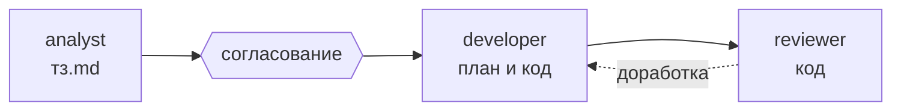

# 1c-team — команда агентов для разработки на 1С

[](plugins/1c-team/.claude-plugin/plugin.json)
[](LICENSE)

Плагин-команда ИИ-агентов для 1С-разработки. Три роли: аналитик пишет ТЗ, разработчик проектирует и пишет код, ревьюер независимо проверяет результат. Команда `/1c-team:task` проводит задачу от постановки до готового кода и останавливается там, где нужно ваше согласование.

## Зачем

- **Процесс вместо одного промпта.** Код не пишется, пока вы не согласовали ТЗ.
- **Минимум ролей.** Отдельный агент — только там, где нужен свой контекст: постановка, реализация и ревью свежим взглядом. Меньше передач между агентами — быстрее и дешевле.
- **Всё остаётся в файлах.** У каждой задачи своя папка: `тз.md` → `код.md` (план и код). Её можно читать, править и передавать коллегам.
- **Независимое ревью.** Ревьюер проверяет код на соответствие ТЗ, ошибки проведения и блокировок, запросы в цикле, права и стандарты 1С.
- **Имена из реальной конфигурации.** Агенты читают исходники через [unica](https://github.com/IngvarConsulting/unica-marketplace) и не выдумывают имена объектов.

## Как это работает



## Состав

| Агент | Роль | Результат |
|---|---|---|
| `analyst` | Изучает текущее поведение, пишет требования Т1…Tn с критериями приёмки и открытыми вопросами, сам проверяет ТЗ по чек-листу | `тз.md` |
| `developer` | Составляет план (метаданные, модули, запросы, права), пишет запросы и код по стандартам 1С | `код.md` или модули |
| `reviewer` | Проверяет код, выдаёт замечания и вердикт «принято / на доработку» | список замечаний |

| Команда | Что делает |
|---|---|
| `/1c-team:task <задача>` | Полный цикл: ТЗ → согласование → код → ревью |
| `/1c-team:spec <задача>` | Только ТЗ и согласование с вами |
| `/1c-team:quick <правка>` | Мелкая правка без ТЗ: правка в основной сессии, затем ревью |

Скилл `spec-template` — шаблон и правила спецификации, по нему работает аналитик.

## Требования и установка

Нужен [Claude Code](https://docs.claude.com/en/docs/claude-code) и плагин `unica`:

```
/plugin marketplace add IngvarConsulting/unica-marketplace
/plugin install unica@unica
```

Затем сам плагин:

```
/plugin marketplace add ivan-manul/1c-team
/plugin install 1c-team@ivan-1c
```

После установки перезапустите сессию Claude Code.

## Пример

```
/1c-team:task Добавить в документ реквизит «Ответственный» и вывести его на форму
```

Команда создаст папку задачи в `docs/specs/`, покажет ТЗ с открытыми вопросами и после вашего согласования перейдёт к решению и коду.

Чтобы процесс соблюдался и без команд, добавьте в инструкции проекта:

```markdown
- Задачи вести агентами 1c-team: analyst → developer → reviewer.
- Код пишется в код.md папки задачи; в модули — только по команде.
```

## Обновление

```
/plugin marketplace update ivan-1c
/plugin update 1c-team@ivan-1c
```

Если вы дорабатываете плагин сами, перед коммитом поднимите `version` в [`plugin.json`](plugins/1c-team/.claude-plugin/plugin.json).

## Благодарности

Идеи ролей и процесса навеяны [rmartynenko/workflow-dev-1c-claude-code](https://github.com/rmartynenko/workflow-dev-1c-claude-code) (MIT). Тексты агентов, команд и шаблона написаны заново.

## Лицензия

[MIT](LICENSE)
