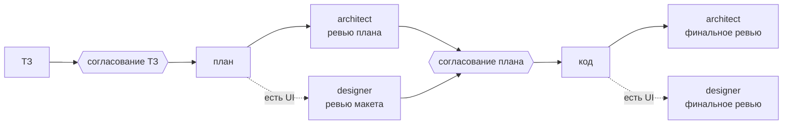

# 1c-team — команда агентов для разработки на 1С

[](plugins/1c-team/.claude-plugin/plugin.json)
[](LICENSE)

Плагин для 1С-разработки с ИИ: ТЗ, план и код пишет основная сессия, а два агента-проверяющих — архитектор и дизайнер — смотрят на них свежим взглядом до и после реализации. Главное решение — план — согласуете вы.

## Зачем

- **План согласует человек.** Код не пишется, пока вы не согласовали ТЗ и план решения.
- **Независимая проверка.** Архитектор проверяет план и итоговый дифф на побочные эффекты: проведение, блокировки, обмены, права, обновление, производительность. Дизайнер подключается, только если меняется интерфейс.
- **Проверяющие ничего не правят.** У них отключены инструменты записи.
- **Мало агентов, правила в скиллах.** Чек-листы и стандарты кода — в скиллах, их применяет и основная сессия.
- **Всё в файлах.** Папка задачи `docs/задачи/<дата-кратко>/`: `тз.md` → `план.md` → `код.md`.
- **ТЗ понятно без контекста.** Начинается с блока «Кратко» простыми словами; необязательные разделы не пишутся.
- **Расширение переживает обновление.** Заимствованные методы — только `&ИзменениеИКонтроль`.
- **Имена из реальной конфигурации.** Исходники читаются через [unica](https://github.com/IngvarConsulting/unica-marketplace).

## Как это работает



ТЗ, план и код пишет основная сессия: у неё весь контекст, и она говорит с вами.

## Состав

| Агент | Когда | Что проверяет |
|---|---|---|
| `architect` | до и после реализации | Архитектуру, место кода, метаданные, побочные эффекты; после — дифф и стандарты кода |
| `designer` | только при изменении интерфейса | Макет и сценарий пользователя; после — готовые формы |

| Скилл | Что внутри |
|---|---|
| `spec-template` | Шаблоны ТЗ (с блоком «Кратко») и плана |
| `code-standards` | Имена, описания методов, перехват в расширении, запросы, проверка |
| `architecture-review` | Чек-лист ревью плана и диффа |
| `ui-review` | Чек-лист ревью интерфейса |

| Команда | Что делает |
|---|---|
| `/1c-team:task <задача>` | ТЗ → план → ревью плана → согласование → код → финальное ревью |
| `/1c-team:spec <задача>` | Только ТЗ и согласование |
| `/1c-team:quick <правка>` | Мелкая правка без ТЗ и плана, затем финальное ревью |

## Требования и установка

Нужен [Claude Code](https://docs.claude.com/en/docs/claude-code) и плагин `unica`:

```
/plugin marketplace add IngvarConsulting/unica-marketplace
/plugin install unica@unica
```

Затем сам плагин:

```
/plugin marketplace add ivan-manul/1c-team
/plugin install 1c-team@ivan-1c
```

После установки перезапустите сессию Claude Code.

## Пример

```
/1c-team:task Добавить в документ реквизит «Ответственный» и вывести его на форму
```

Команда создаст папку задачи в `docs/задачи/`, покажет ТЗ, затем план с замечаниями архитектора и дизайнера и только после вашего согласования перейдёт к коду.

Чтобы процесс соблюдался и без команд, добавьте в инструкции проекта:

```markdown
- Задачи вести по процессу 1c-team: ТЗ → план → ревью architect/designer → код → финальное ревью.
- Код пишется в код.md папки задачи; в модули — только по команде.
```

## Обновление

```
/plugin marketplace update ivan-1c
/plugin update 1c-team@ivan-1c
```

Если вы дорабатываете плагин сами: прогоните 2–3 эталонные задачи до и после правки и сравните качество и расход токенов, затем поднимите `version` в [`plugin.json`](plugins/1c-team/.claude-plugin/plugin.json).

## Благодарности

Идеи ролей и процесса навеяны [rmartynenko/workflow-dev-1c-claude-code](https://github.com/rmartynenko/workflow-dev-1c-claude-code) (MIT). Тексты агентов, команд и скиллов написаны заново.

## Лицензия

[MIT](LICENSE)
